<div align="center">
  <a href="https://damndev.xyz">
    
  </a>
</div>

<br />

<table>
  <tr>
    <td width="72%" valign="top">
      <h3>OPERATOR DOSSIER // CALLSIGN: DAMNDEV</h3>
      <p>
        Software architect and systems engineer building under the callsign <b>Poor Potato</b> (<b>DamnDev</b>). Specialized in low-latency Discord Gateway integrations, client-side runtime reverse engineering, headless automation daemons, and full-stack platforms with interactive 3D interfaces.
      </p>
      <p>
        Architectural focus centers on resilient asynchronous I/O, lean dependency trees, and writing backend services that survive production edge cases without memory creep.
      </p>
      <p>
        <code>NODE.JS</code> · <code>TYPESCRIPT</code> · <code>PYTHON</code> · <code>POSIX SHELL</code> · <code>UBUNTU</code> · <code>CLOUDFLARE</code>
      </p>
    </td>
    <td width="28%" align="center" valign="middle">
      <a href="https://github.com/69poorpotato">
        
      </a>
      <br />
      <sub>
        <b>TOKEN: 242512219</b><br />
        <code>damndev.xyz</code>
      </sub>
    </td>
  </tr>
</table>

<br />

<div align="center">
  
</div>

<br />

<div align="center">
  
</div>

<br />

### ACTIVE RUNTIMES &amp; REGISTRY

| Target System | Domain &amp; Architecture | Core Stack | Status |
| :--- | :--- | :--- | :--- |
| **[`damndev.xyz`](https://damndev.xyz)** | Flagship portfolio, interactive spatial canvas, edge deployment | Next.js, React, Three.js, Node.js | `PRODUCTION` |
| **[`potatobot`](https://github.com/69poorpotato/potatobot)** | Modular Discord bot runtime, gateway event lifecycle | Python, Discord Gateway API | `ACTIVE` |
| **[`ai-image-detector`](https://github.com/69poorpotato/ai-image-detector-py)** | Synthetic visual artifact detection &amp; heuristics | Python, JavaScript | `OPEN SOURCE` |
| **[`discordjs-bot-template`](https://github.com/69poorpotato/discordjs-bot-template)** | Boilerplate architecture for scalable bot microservices | JavaScript, discord.js | `MAINTAINED` |
| **[`discord-all-indicators`](https://github.com/69poorpotato/discord-all-indicators)** | Real-time presence inspection &amp; client indicators | JavaScript, Web APIs | `ACTIVE` |
| **[`pterodactyl-installer`](https://github.com/69poorpotato/pterodactyl-installer)** | Linux infrastructure deployment automation scripts | POSIX Shell, Ubuntu/Debian | `MAINTAINED` |
| **[`automated-dispatch`](https://github.com/69poorpotato/whatsapp-automated-messages-sender-js)** | Headless messaging daemons &amp; session queue dispatch | JavaScript, Python | `DEPLOYS` |

<br />

### UPSTREAM CONTRIBUTIONS &amp; INTERNALS

- **[Vendicated/Vencord](https://github.com/Vendicated/Vencord)** — Core Discord client modification. Engineered voice channel status character limitation handling and client-side patch validations.
- **[discordjs/discord.js](https://github.com/discordjs/discord.js)** — Standard Node.js gateway library. Contributed fixes to thread channel protocols and client permission evaluation flows.
- **Client Modding Ecosystem** — Active inspection and module patching across BetterDiscord, Vencord, and custom Webpack modules.

<br />

### ACTIVITY &amp; DISPATCH TELEMETRY

<div align="center">
  <a href="https://github.com/69poorpotato">
    
  </a>
  <a href="https://github.com/69poorpotato">
    
  </a>
</div>

<br />

### COMMS &amp; ENDPOINTS

```
[ENDPOINT]  https://damndev.xyz
[COMMUNITY] https://discord.gg/NuKPJdREaV
[SYSTEM]    Ubuntu 24.04 LTS (Headless) // Cloudflare Edge
[IDENTITY]  Poor Potato // DamnDev // UID: 242512219
```

<div align="center">
  <sub><code>DAMNDEV // ZERO BLOAT // PURE RUNTIME // 2026</code></sub>
</div>
