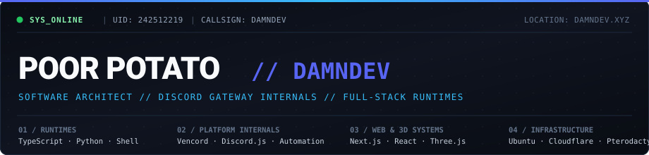

  
    
  

 

### about me

hey, i'm **poor potato** (also known as **damndev**). i'm a developer focused on building discord bots, automation scripts, and web apps.

most of my projects involve backend logic, creating custom bots, and writing tools to automate everyday tasks with python and javascript.

 

  

 

### featured projects

- **[damndev.xyz](https://damndev.xyz)** - personal website and portfolio built with Next.js and Three.js.
- **[potatobot](https://github.com/69poorpotato/potatobot)** - custom Discord bot built with Python.
- **[ai-image-detector-py](https://github.com/69poorpotato/ai-image-detector-py)** / **[ai-image-detector-js](https://github.com/69poorpotato/ai-image-detector-js)** - tools to detect and identify AI-generated images.
- **[discordjs-bot-template](https://github.com/69poorpotato/discordjs-bot-template)** - clean boilerplate template for building Discord bots with JavaScript.
- **[whatsapp-automated-messages-sender](https://github.com/69poorpotato/whatsapp-automated-messages-sender-js)** - scripts for automating and scheduling messages.
- **[discord-all-indicators](https://github.com/69poorpotato/discord-all-indicators)** - lightweight script for inspecting Discord client status indicators.

 

### github stats

  
  

 

### links

- website: [damndev.xyz](https://damndev.xyz)
- github: [github.com/69poorpotato](https://github.com/69poorpotato)
