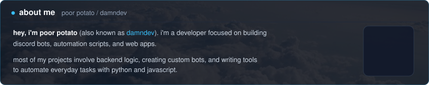
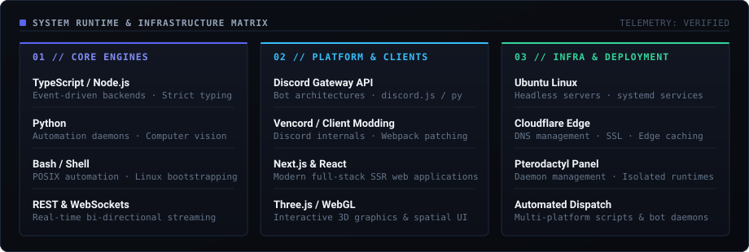
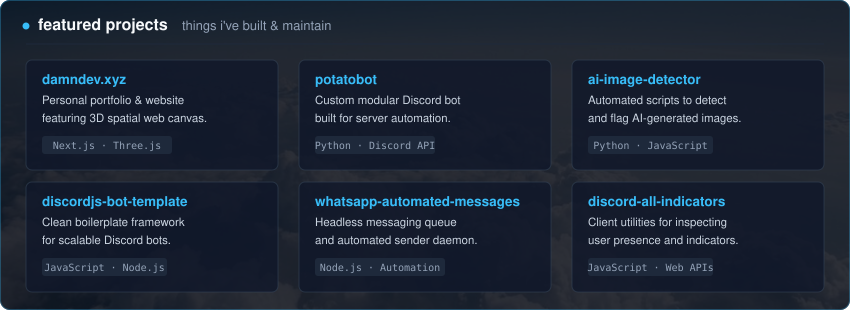
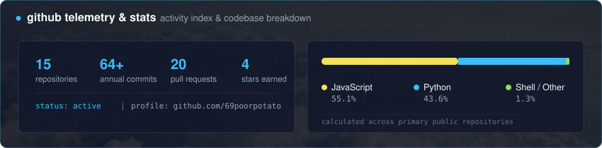
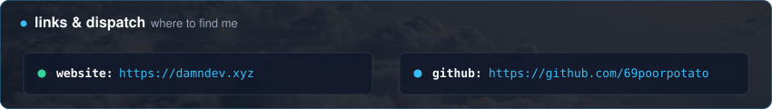

  

 

  

 

  

 

  

  
<b>browse direct repository links</b>

   
  <ul>
    <li><a href="https://damndev.xyz">damndev.xyz</a> — personal website &amp; portfolio built with Next.js and Three.js</li>
    <li><a href="https://github.com/69poorpotato/potatobot">potatobot</a> — custom Discord bot built with Python</li>
    <li><a href="https://github.com/69poorpotato/ai-image-detector-py">ai-image-detector-py</a> / <a href="https://github.com/69poorpotato/ai-image-detector-js">ai-image-detector-js</a> — tools to detect AI-generated images</li>
    <li><a href="https://github.com/69poorpotato/discordjs-bot-template">discordjs-bot-template</a> — boilerplate template for Discord bots in JavaScript</li>
    <li><a href="https://github.com/69poorpotato/whatsapp-automated-messages-sender-js">whatsapp-automated-messages-sender</a> — scripts for automating messages</li>
    <li><a href="https://github.com/69poorpotato/discord-all-indicators">discord-all-indicators</a> — lightweight utility for Discord status indicators</li>
  </ul>

 

  

 

  

 

  <a href="https://damndev.xyz">website: damndev.xyz</a> &nbsp;|&nbsp; <a href="https://github.com/69poorpotato">github: github.com/69poorpotato</a>

